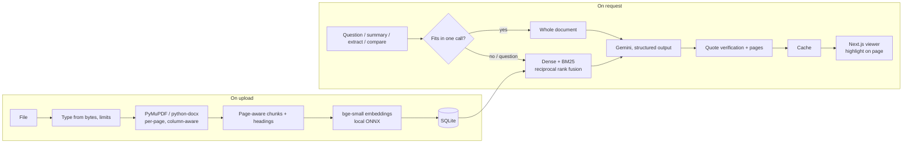

# Margin: a document assistant you can check

Upload a contract, paper, policy or report. Margin summarises it, answers questions, pulls out key facts and compares documents, and **every claim comes with a quote that is verified against the page** and highlighted on the real page in one click.

> This repository was the *AI Document Summarizer* (v1: one FastAPI endpoint that sent a PDF's text to Gemini). Version 2 is a rebuild; see [what changed](#what-changed-from-v1).

**Live demo:** _coming soon (being deployed)_ · **Case study:** `/case-study` in the app · **Status:** working prototype; answer-quality evals pending an API key

## What it does

| | |
|---|---|
| **Summary** | Executive summary, key takeaways and a section-by-section summary; free outline from detected headings |
| **Ask** | Questions answered only from the document, with "the document doesn't say" when it doesn't, and a trace of which passages were searched |
| **Key facts** | People and organisations, dates and deadlines, figures, decisions, risks, action items, each with its source |
| **Compare** | Two documents side by side: in common, different, only in one |
| **Library** | Private workspace, search across every document, past analyses kept |

Every AI claim is labelled **stated** (the document says it) or **interpretation**, and each quote is checked: **verified** (found word for word), **approximate**, or **not found**.

## Architecture



Key decisions (details in the case study):
- **Verify, don't trust, citations.** The model cites passage labels and verbatim quotes; the server normalises each quote and finds it in the cited passage or elsewhere in the document before the UI marks it verified.
- **Local embeddings, no vector DB.** bge-small via fastembed (~130 MB RAM, no key, no per-call cost). Per-document search over hundreds of vectors is milliseconds with NumPy.
- **Whole document when it fits** (summaries and extraction up to ~180k characters), **map-reduce** above that, **retrieval** for questions.
- **Cache** keyed on content, prompt version and model; only real model calls count towards the per-workspace hourly limit.
- **Workspace tokens:** no sign-up; the server stores a SHA-256 hash of a random bearer token and scopes every query to it.

## Evaluation

Retrieval (no API key; runs in CI): 4 synthetic documents (15 pages, 47 chunks) and 47 answerable questions labelled with the page holding the answer.

| Scoped to the document | hit@1 | hit@3 | hit@6 | MRR |
|---|---|---|---|---|
| Dense (bge-small) | 0.83 | 0.957 | 0.979 | 0.892 |
| BM25 | 0.681 | 0.872 | 0.936 | 0.787 |
| Hybrid (RRF) | 0.787 | 0.915 | 1.0 | 0.866 |

On this set dense search alone is as good as or better than hybrid except at hit@6; hybrid is kept for identifier-heavy queries the set covers thinly. The set is small and was written by the same person who built the pipeline, so treat it as a regression suite. Full results, the library-wide table and an ablation: [`backend/evals/results/retrieval.md`](backend/evals/results/retrieval.md).

Answer quality (`backend/evals/run_generation.py`: accuracy, correct refusals on 7 unanswerable questions, verified-claim rate, latency, tokens) **has not been run yet**; it needs a Gemini key.

## Run it locally

Requirements: Python 3.11+, Node 20+.

```bash
cd backend
python -m venv .venv && source .venv/bin/activate   # Windows: .venv\Scripts\activate
pip install -r requirements-dev.txt
cp .env.example .env        # add GEMINI_API_KEY, or set LLM_PROVIDER=offline-demo
uvicorn app.main:app --reload --port 8000
```

```bash
cd frontend
npm install
echo "NEXT_PUBLIC_API_URL=http://localhost:8000" > .env.local
npm run dev                 # http://localhost:3000
```

Without a key, upload, reading, search and citations work; AI features return a clear "AI not configured" message. `LLM_PROVIDER=offline-demo` fills them with sentences copied from the document (labelled as not AI everywhere) so the whole interface can be explored.

## Tests and checks

```bash
cd backend && pytest && ruff check . && python -m evals.run_retrieval
cd frontend && npm test && npm run typecheck && npm run lint
```

42 backend tests run against a fake model: parsing (scanned, encrypted, two-column and oversized files), chunking, quote verification, retrieval, workspace isolation, path traversal, caching, map-reduce, rate limiting and error handling.

## Deploy

- **Backend:** `backend/Dockerfile` runs on Hugging Face Spaces (Docker SDK, port 7860) or any container host. Set `GEMINI_API_KEY` as a secret and `CORS_ORIGINS` to the frontend URL. Storage is SQLite on local disk: fine for a demo, reset when the container restarts.
- **Frontend:** Vercel (root directory `frontend`), with `NEXT_PUBLIC_API_URL` pointing at the backend.

## Project layout

```
backend/
  app/ingest/      file detection, PDF/DOCX/text parsing, column-aware reading, chunking
  app/retrieval/   embeddings (fastembed or hashing), BM25 + dense + RRF
  app/llm/         Gemini client (structured output, retries, usage), schemas, versioned prompts, offline demo
  app/grounding.py quote verification
  app/services/    documents and analyses (summary, Q&A, extraction, comparison)
  tests/  evals/
frontend/src/
  app/             library, document workspace, compare, case study
  components/      page viewer with highlights, claims and citation chips, analysis panel
```

## What changed from v1

v1 had a UTF-16 `requirements.txt` pip couldn't read, imported PyMuPDF without listing it, crashed at start-up without a key, wrote uploads using the client's filename (path traversal), returned every error as a 500, printed the API key in a script, and had no chunking, retrieval, citations, tests or UI. All of that is replaced.

## Limitations and next steps

- No OCR yet: scanned PDFs are detected and explained, not read.
- Anonymous workspaces: no accounts, sharing or recovery.
- Evaluation data is synthetic and small; answer-quality evals are pending a key; no usability testing yet (a study plan is in the case study).

## Skills this project demonstrates

RAG system design (chunking, hybrid retrieval, RRF), LLM integration with structured outputs and grounding checks, retrieval evaluation and ablation, FastAPI service design, security (authorization, upload validation), testing with model fakes, CI, Docker, and product design: information architecture, evidence-first interaction design, accessibility and a design system across light and dark themes.

Suited roles: AI Engineer, Generative AI Engineer, AI Application Developer, AI Product Designer.

## Author

**Anuj M** · [LinkedIn](https://www.linkedin.com/in/anuj1102001/) · [GitHub](https://github.com/anuj1102001)

Built with an AI coding assistant (Claude Code) under my direction: I set the product direction and requirements, and reviewed the design, code and evaluations.
